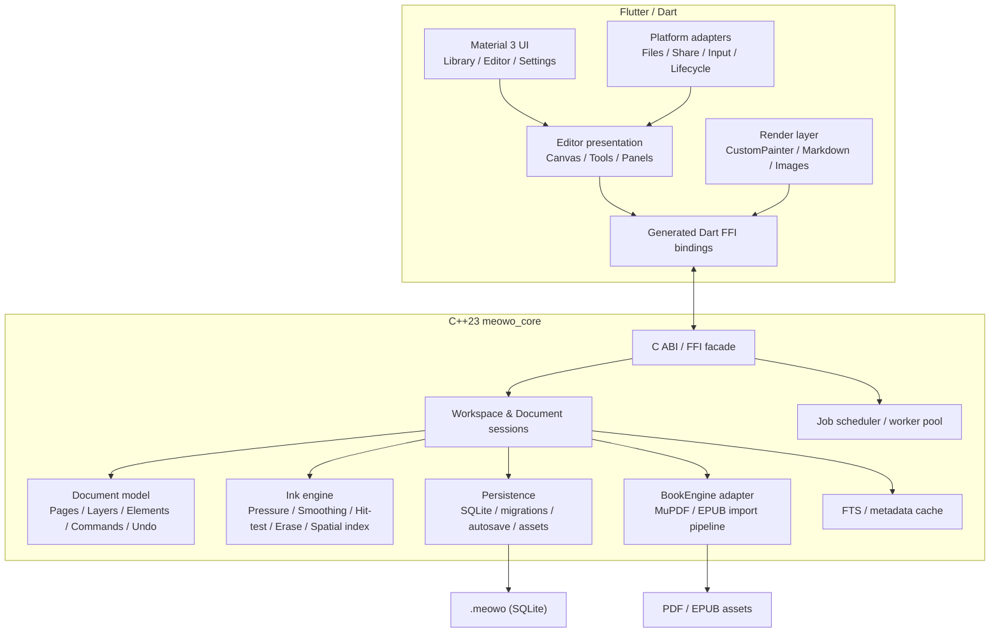

# 02 · 技术架构（Technical Architecture）

- 状态：Baseline
- 版本：v0.1.0
- 最后更新：2026-10-19
- 关联：需求见 [01-functional-requirements.md](01-functional-requirements.md)，数据格式见 [03-document-format.md](03-document-format.md)，决策见 [09-decisions-and-open-questions.md](09-decisions-and-open-questions.md)

---

## 1. 架构目标

1. 在 Android/Windows/Linux 共用一套 Flutter UI 与一套 C++ 文档核心。
2. 手写输入链路尽可能短，笔尖到反馈不因存储、搜索、图书渲染而阻塞。
3. 文档、元素、图层与几何有唯一权威模型，避免 Flutter 与 C++ 各存一份“真相”。
4. 文件格式、FFI 边界、图书引擎可版本化、可替换、可单测。
5. 高频路径（笔迹、命中测试、视口裁剪）可独立性能剖析。
6. 不在 1.0 引入不必要的服务端、账号、数据库代理或跨进程架构。

## 2. 总体结构



### 2.1 权威边界

| 关注点 | 权威位置 | Flutter 中的角色 |
|---|---|---|
| 持久化文档数据 | C++ / SQLite | 只读 view model 与 UI 状态 |
| 页面、图层、元素、笔迹几何 | C++ 内存模型 | 请求数据并渲染；持有临时预览 |
| 撤销/重做（对象/画布） | C++ Command/History | 触发、显示可用状态 |
| 文本内容 | Markdown 源文本（C++ 持久化） | 编辑缓冲区、解析、预览、提交 |
| 文本撤销 | Flutter 文本控件（局部） | 提交时形成一个 C++ 全局撤销单元 |
| 相机（平移/缩放） | Flutter UI 状态 | 可持久化每页相机位置到文档偏好 |
| 进行中的笔迹 | Flutter 预览 + C++ 接收增量 | 手势结束后由 C++ 固化 |
| 选择状态 | Flutter UI 状态 | 查询 C++ 几何/命中结果 |
| 图书页位图 | C++ BookEngine 渲染 → Dart 纹理缓存 | 绘制 `ui.Image`，不解析源文件 |
| 资料库缓存与索引 | C++ Workspace / SQLite | 展示、筛选、发起操作 |
| 设置 | Flutter（simple prefs）+ C++ 可读的必要项 | 通过显式同步接口写入核心 |

**禁止**：Flutter 直接打开 `.meowo` SQLite；Flutter 修改持久化文件；C++ 依赖 Flutter 的类型或 UI 生命周期。

## 3. 技术栈与版本策略

| 层 | 选型 | 说明 |
|---|---|---|
| UI | Flutter stable + Material 3 | 固定 Flutter 版本并在 `pubspec.lock`、CI 中固定；升级需单独任务 |
| 语言 | Dart 3 / C++23 | C++ 使用 `CMAKE_CXX_STANDARD 23`；避免依赖编译器未稳定的实验特性 |
| 状态管理 | Riverpod | 依赖注入、异步状态、生命周期清晰；避免全局可变单例 |
| 路由 | go_router | 深链/资料库→编辑器/设置；路由参数只传稳定 ID |
| FFI | Dart `ffi` + `ffigen` | C ABI 稳定边界；生成代码提交并校验 |
| 存储 | SQLite 3（amalgamation 或系统库统一方案） | WAL、事务、FTS5；必须跨三平台版本一致 |
| 序列化 | FlatBuffers（元素 payload、图书页元数据） | 版本化、零拷贝解析、可 fuzz；schema 源文件入库 |
| PDF/EPUB | MuPDF 1.26.3（AGPL） | 统一渲染为固定页 PNG；保留源文件；许可证义务见 OQ-011 |
| EPUB | MuPDF 1.26.3（AGPL） | 导入时固定 A4 布局并渲染为页面；保留原 EPUB；不提供重排 |
| 文本渲染 | Dart Markdown parser + Flutter widgets | 本地渲染；公式用 KaTeX 兼容实现；不使用远程资源 |
| 构建 | CMake + Ninja + CTest | C++ 核心独立构建；Flutter FFI 插件集成 |
| 测试 | GoogleTest/GoogleMock + flutter_test + integration_test | C++ 单测、Dart Widget、端到端 |
| 静态检查 | clang-format/clang-tidy、dart format/analyze、自定义 lint | CI 阻断 |
| 依赖管理 | 最小依赖 + 许可证清单 | 新增原生依赖必须评审 |

版本号不在此文档硬编码；Phase 0 将实际版本写入 `tools/versions.md` 与 CI 矩阵。任何升级必须跑完整测试与格式/基准回归。

## 4. 仓库结构

```text
Meowo/
├── apps/
│   └── meowo/                         # Flutter app
│       ├── lib/
│       │   ├── app/                   # app shell, theme, routing
│       │   ├── features/
│       │   │   ├── library/
│       │   │   ├── editor/
│       │   │   ├── books/
│       │   │   ├── attachments/
│       │   │   └── settings/
│       │   ├── rendering/             # canvas, text, image, book page renderers
│       │   ├── platform/              # file pickers, share, input, lifecycle
│       │   └── l10n/
│       ├── test/
│       └── integration_test/
├── packages/
│   └── meowo_core/                    # Flutter FFI plugin
│       ├── lib/                       # Dart API + generated bindings
│       ├── native/
│       │   ├── include/meowo/         # public C ABI headers
│       │   ├── src/
│       │   │   ├── base/
│       │   │   ├── document/
│       │   │   ├── ink/
│       │   │   ├── storage/
│       │   │   ├── book/
│       │   │   ├── search/
│       │   │   ├── ffi/
│       │   │   └── jobs/
│       │   ├── schema/                # FlatBuffers schemas
│       │   ├── tests/
│       │   ├── third_party/
│       │   └── CMakeLists.txt
│       ├── test/
│       └── ffigen.yaml
├── tools/                             # scripts, generators, benchmark harness
├── assets/                            # brand, fonts, public test fixtures
├── docs/agent/
└── .github/workflows/
```

### 4.1 模块依赖方向

```text
base ← document ← ink
  ↑        ↑
storage ← search
  ↑
book
  ↑
ffi / jobs
```

- `base` 不依赖业务模块。
- `document` 不依赖具体数据库、MuPDF 或 Flutter。
- `ink` 依赖几何与文档元素抽象，不依赖渲染后端。
- `storage` 实现文档持久化；`document` 通过接口调用。
- `book` 封装外部引擎；不得让 MuPDF 类型进入业务层。
- `ffi` 只做 ABI 转换、句柄与错误边界。

## 5. C++23 核心设计

### 5.1 基本约定

- C++ 标准：C++23；优先使用 RAII、`std::expected`、`std::span`、`std::ranges`、`std::string_view`。
- 不使用 C++ 模块（modules）作为 1.0 构建基础，避免 Android NDK/跨平台工具链风险；采用头文件 + 命名空间。
- 不使用异常跨越 C ABI；内部如需异常/第三方异常，在 FFI facade 捕获并转换为错误码。
- 禁止裸 `new/delete`；所有权用 `std::unique_ptr`/容器/值类型。
- 公共头文件只暴露必要类型；内部实现细节放 `src/`。
- 所有持久化数据使用显式小端字节序（FlatBuffers 自身保证）；浮点使用 IEEE 754。
- 时间统一 Unix epoch 毫秒（UTC），显示层本地化。
- ID 使用 UUIDv7（时间有序）的 16 字节或 canonical string；对外使用 string，内部可二进制。

### 5.2 主要模块职责

#### `base`

- `Result<T, Error>` / 错误码与用户可翻译错误 key；
- ID、时间、字节缓冲、UTF-8 校验；
- 日志接口（平台可注入 sink）；
- 取消令牌（CancellationToken）；
- 几何基础：`Point`, `Rect`, `Affine2`, `Path` 查询辅助；
- 版本与 ABI 握手。

#### `document`

- 文档、页面、图层、元素模型；
- 不变量校验；
- 命令系统：Add/Remove/Update/Transform/Reorder、页面操作、图层操作、文本提交；
- Undo/Redo 历史、事务边界；
- 选择/可见性查询的模型基础；
- 变更事件（版本号、变更集合）。

#### `ink`

- 笔刷模型与压力曲线求值；
- 点采样、去抖、平滑、曲线拟合；
- 笔迹宽度/轮廓生成所需的几何；
- 命中测试（笔迹、橡皮半径）；
- 像素擦除的几何裁剪与分段；
- 空间索引（四叉树/R-tree；实现细节由基准决定）；
- 视口查询和可见元素列表；
- 未来可加入倾斜笔锋/纹理，但不得改变旧笔迹解释。

#### `storage`

- SQLite schema 与迁移；
- 文档创建/打开/关闭/保存；
- 事务、WAL、检查点；
- 资产存储与哈希校验；
- 图书页/缩略图缓存；
- 文件锁与只读模式；
- 一致性快照导出。

#### `book`

- `BookEngine` 接口与注册表；
- MuPDF 适配器（PDF/EPUB 统一）；
- EPUB 固定页布局与源文件保留；
- 图书页渲染请求、优先级、取消、位图输出；
- 目录、页数、页面尺寸、元数据；
- 页面缓存与错误隔离。

#### `search`

- FTS5 索引维护；
- 文档标题/文本元素索引构建；
- 查询、结果排序与 snippet；
- 索引重建。

#### `ffi` / `jobs`

- C ABI 函数、opaque handle、版本、错误；
- 回调到 Dart isolate；
- 工作线程池、任务队列、取消、生命周期；
- 防止回调在文档销毁后触发。

### 5.3 文档会话与锁

- 每打开一个文档创建一个 `DocumentSession`。
- 同一文档同时只允许一个可写会话；通过文件锁或工作区协调器保证。
- 文档会话负责：内存模型、当前页缓存、撤销栈、自动保存任务、图书页缓存、事件发送。
- 关闭文档时：
  1. 停止接受新命令；
  2. 完成/取消正在进行的渲染与导入任务；
  3. flush 自动保存；
  4. checkpoint WAL；
  5. 释放锁；
  6. 释放会话。
- 应用异常崩溃后，SQLite WAL 自动恢复已提交事务。

### 5.4 命令与撤销

- 所有改变元素/页面/图层的操作经由 Command 执行。
- 命令具备：
  - `apply`：验证前置条件并产生变更；
  - `invert`/undo payload；
  - 影响范围（page IDs、layer IDs、element IDs）；
  - 是否可合并（例如连续移动同一选择）。
- 一次完整手势/拖拽/文本提交是单一事务（一个 undo 单元）。
- 历史只存内存，不持久化；文档关闭后清空。
- 大对象（笔迹）不可在历史中复制多份；使用引用计数/不可变快照或增量差异。基准必须验证 20k 笔迹下撤销内存上限。
- 历史容量采用内存预算（例如 256 MB 上限或最近 N 条，具体在实现时基准确定），超过时丢弃最旧记录，不破坏当前文档状态。

### 5.5 自动保存

- 编辑事务提交后进入 dirty 集；
- 自动保存调度器在短 debounce 后批量写入；书写过程中不逐点落盘；
- 手势结束或事务提交是关键持久化边界；
- 保存失败：保留 dirty 状态、重试、显示明确 UI；不得标记“已保存”；
- 应用进入后台/窗口关闭/系统低内存回调时立即 flush；
- 数据库写入在专用线程执行，UI/绘制不等待磁盘；
- 每次写入使用事务；WAL 允许并发读，但 C++ 层保持单写者。

### 5.6 错误模型

- 内部错误码稳定；对外带：
  - `code`（机器可读）；
  - `messageKey`（本地化 key）；
  - `detail`（开发诊断，不含用户内容）；
  - `retryable`；
  - 可选 `path`/`pageId`（安全范围内）。
- FFI 不抛 C++ 异常。
- 用户可见错误由 Dart 映射为本地化文案；不得把 SQLite/MuPDF 原始英文错误直接展示。

## 6. FFI 契约

### 6.1 设计原则

- 只暴露 C ABI；C++ 名称 mangle 不进入 Dart。
- 所有 handle 为 opaque 指针 + 类型/代数校验，防止 use-after-free 被误用。
- 同步 API 只做内存操作；任何可能 >2 ms 的工作改为异步 job。
- 字符串 UTF-8，显式长度，允许 NUL；Dart 负责复制到自己的内存。
- 数组/二进制数据明确所有权和释放函数（`meowo_free_*`）。
- 所有入口验证版本、参数、文档状态；错误通过线程局部 last-error 或结果对象返回。
- 回调只在初始化时注册，通过 `NativeCallable.listener` 投递到 Dart；回调携带 `sessionToken` 与事件序号，避免旧会话事件污染新会话。
- ABI 版本：
  - major 不兼容，Dart 启动时检查；
  - minor 向后兼容新增函数/字段；
  - 生成绑定与核心库版本必须匹配，CI 检查。

### 6.2 分层 Dart API

C ABI 不直接被业务 Widget 调用。Dart 包提供：

- `MeowoRuntime`：初始化、版本、日志、工作区；
- `LibraryRepository`：列表、搜索、导入、导出、删除；
- `DocumentSession`：打开/关闭、页面、图层、元素、命令、事件；
- `InkController`：开始/追加/结束笔画；
- `BookController`：页渲染、目录、导入；
- `JobHandle`：异步任务状态/取消。

业务层通过 Riverpod providers/controllers 使用这些接口，禁止在 UI 中散落 `Pointer`/`ffi` 调用。

### 6.3 典型调用流

#### 打开文档

1. Dart 请求打开 `.meowo`。
2. C++ 校验文件、版本、锁、schema。
3. 加载文档元数据与当前页元素（或首页 + 视口）。
4. 返回文档摘要、页面列表、缓存的事件序号。
5. Dart 建立 view state，请求渲染所需缩略图/页面背景。

#### 书写笔画

1. Flutter `Listener` 收到 stylus down，Dart 调用 `beginStroke(tool, settings, point)`。
2. C++ 校验活动图层、锁定/可见性，创建临时笔画对象，返回必要渲染数据。
3. 每个 move 事件批量送入 C++；C++ 做平滑/压力曲线处理，返回增量几何或让 Dart 继续渲染预览。
4. Flutter 在独立 painting 层绘制进行中的笔画，不重建整个画布。
5. pen up：C++ 结束笔画、生成元素、推入 undo、标记 dirty、返回元素 ID 和版本。
6. Autosave 调度器异步事务写入。
7. 若 C++ 拒绝（锁定图层、文档关闭），Dart 丢弃预览并提示。

> 实现可选择让 Dart 使用 C++ 返回的规范化点集渲染；无论采用哪一种，压力/平滑算法只能有一个权威实现，预览与最终笔迹不能出现可感知跳变。

#### 书页渲染

1. Dart 请求某页指定缩放级别的位图。
2. C++ 检查缓存；未命中则提交 BookEngine 任务，低优先级排队。
3. MuPDF 在 worker 线程渲染 RGB/RGBA 缓冲。
4. 回调/事件返回 buffer 元数据与 job 结果。
5. Dart 创建 `ui.Image` 并缓存，绘制在图书背景层。
6. 视口变化时取消不可见页任务，保留有限缓存。

#### 导入 EPUB（推荐管线）

1. 用户选择 EPUB 和纸张/可读性设置。
2. C++ 校验 ZIP、容器 XML、OPF、DRM、路径安全。
3. 在临时目录/临时数据库生成固定分页的中间文档或 PDF 页面快照（具体引擎待定）。
4. 逐页保存图书页元数据与渲染源；保留原 EPUB 作为源资产。
5. 创建文档、写入页面映射、生成缩略图。
6. 原子移动到资料库并返回。
7. 失败/取消清理临时文件，不写入资料库。

### 6.4 FFI 测试

- 每个导出函数有正常/错误/生命周期测试。
- 句柄在关闭后调用必须返回明确错误，不崩溃。
- 回调在关闭后不得触发。
- 大数据 buffer 生命周期/释放次数检测（ASan/LSan）。
- Dart/FFI 绑定版本不匹配测试。
- 禁止手工修改生成的绑定文件；CI 重新生成并检查 diff。

## 7. Flutter 架构

### 7.1 应用分层

```text
UI Widgets
  ↓
Feature controllers / view models（Riverpod）
  ↓
Domain services (DocumentController, LibraryController, BookController)
  ↓
meowo_core Dart API（FFI 包）
  ↓
C++ core
```

- Widget 不直接访问数据库/FFI；UI 只消费状态与调用 controller。
- 控制器不持有不可恢复的跨页面全局状态；文档关闭时释放。
- 编辑画布拆分：
  - `CanvasViewport`（相机、手势仲裁）；
  - `CanvasScene`（渲染层/元素）；
  - `CanvasOverlay`（选择框、工具光标、浮动工具条）；
  - `EditorShell`（顶栏、工具条、面板、页面导航）。
- 避免一次 `setState` 重建整页；按层/区域监听。
- 文本编辑由 Flutter 原生文本输入承载，不自己实现 IME。

### 7.2 状态模型

- 不可变 view state + controller 事件。
- 每页有独立的 element/rendering state，减少无关重绘。
- 大集合查询通过 C++ 视口查询，Dart 只保存可见/附近的渲染数据与少量缓存。
- 选择、缩放/相机、工具设置是短期 UI 状态；提交后的文档变化由 C++ 事件驱动。
- 失败的操作要能回滚 UI 乐观更新；默认先等待核心确认再显示“已提交”，但笔迹预览可乐观显示。

### 7.3 UI 与业务解耦

- Material 3 主题、设计 token 集中在 `app/theme/`。
- 自适应布局基于可用宽度/输入类型，不按设备型号硬编码。
- 所有用户可见字符串在 ARB/本地化资源；所有快捷键有可测试的 action 映射。
- 对平台能力的调用（文件选择、分享、外部打开、屏幕方向、输入笔检测）放在 `platform/` 适配层，便于 mock。

## 8. 渲染策略

### 8.1 画布

- 使用 `CustomPainter`/`Picture`/分层 `RepaintBoundary`，不把整个文档变成单一巨大 widget 树。
- 元素按页面/图层/空间索引查询后，仅生成视口内绘制指令。
- 静态内容按图块或元素级缓存；进行中的笔画单独绘制，避免全画布重绘。
- 笔迹渲染：
  - 依据中心线 + 压力宽度生成平滑轮廓（mesh 或 path）；
  - 路径缓存到元素版本；缩放时重新栅格化而非放大位图；
  - 高亮笔使用透明度/混合模式；需要时使用离屏层避免叠加变黑。
- 文本使用 Flutter 文本布局；Markdown 预览按块缓存，仅重排变更块。
- 图片使用解码/降采样缓存；同一资产不同显示尺寸有限缓存，避免内存膨胀。
- 图书页是异步位图；加载期间显示页框和骨架，不能阻塞批注层显示。
- 缩放/平移手势期间允许低细节策略（如暂时使用已缓存低分辨率页），手势结束后补齐清晰层。
- 不以保证 120 Hz 为绝对目标，但在支持设备上使用系统刷新率且不能人为限制。

### 8.2 坐标与精度

- 文档坐标用 double；UI 相机用 double。
- 笔迹点在元素局部坐标系存储，使用相对元素锚点的有限精度数据，避免无限画布远坐标导致 float32 精度损失。
- 仿射变换统一处理平移/缩放/旋转；文本布局使用未缩放局部坐标。
- 页面坐标原点：左上角，x 向右，y 向下，单位为 point（1/72 英寸）。
- 无极画布允许负坐标；初始原点不设死边界。
- 缩放极限与平移边界见 UX 规范；无极画布不强制回弹到内容边界。

### 8.3 图书页

- PDF 页面渲染为位图，按 zoom bucket 缓存；页面源数据自包含。
- 对低缩放级使用缩略图/低清页，高缩放级按需渲染。
- 渲染尺寸受内存预算约束：单页超大时只渲染视口 tile 或限制最大像素，避免 OOM。
- EPUB 建议在导入时固化为固定页面（理想为页面快照 PDF/结构化固定布局），避免不同平台/时间重新分页导致批注错位。该策略与引擎选择在 Phase 0 验证。

## 9. 输入架构

### 9.1 输入抽象

```text
Platform pointer events
  → InputEventNormalizer（kind/stylus/touch/mouse、pressure、tilt、coalesced）
  → GestureArbiter（绘制 vs 平移 vs 缩放 vs 文本选择）
  → ToolController（pen/highlighter/eraser/lasso/...）
  → InkController / SelectionController
```

- 优先使用 Flutter 原始 `PointerEvent`；若某平台无法提供压力/笔类型，增加最小平台适配层，不改变上层 API。
- 记录输入能力探测结果：是否区分 stylus、压力值范围、是否提供 tilt、coalesced/predicted events。
- 手掌抑制状态机在 `GestureArbiter` 中实现，并有单元测试（不依赖真实硬件）。
- 工具状态切换不应改变笔迹正在进行的绘制；完成当前笔画后再应用新工具。

### 9.2 事件循环预算

- Pointer down/move/up 的 Dart 处理必须避免同步 I/O、JSON 大对象、整页重建。
- 点数据批量传递；每个事件不分配大量临时对象。
- 保存、搜索、图片解码、图书页渲染都不得在 pointer 处理路径中等待。
- 文本输入法组合事件与画布手势隔离。

## 10. 平台集成

| 能力 | Android | Windows | Linux |
|---|---|---|---|
| 文件导入/导出 | Storage Access Framework | 文件选择器/拖放 | XDG portal/文件选择器/拖放 |
| 分享 | Android Sharesheet | 可复制/另存 | 可复制/另存 |
| 外部打开附件 | Intent + FileProvider | ShellExecute | xdg-open |
| 笔输入 | MotionEvent tool type/pressure | WM_POINTER + Flutter 事件 | 桌面环境/Wayland/X11 能力探测 |
| 生命周期 | Activity lifecycle | 窗口消息/生命周期 | 应用生命周期信号 |
| 高 DPI | 系统密度 | Per-monitor DPI | 系统缩放 |
| 存储路径 | App-specific storage | `%LOCALAPPDATA%`/用户目录 | XDG data/cache |

原则：

- 所有路径使用平台 API 获取；不硬编码 `/sdcard`、`C:\`、`~`。
- Android 使用 SAF 避免存储权限范围问题；应用资料库在应用私有目录。
- 桌面导出通过用户选择的目标路径写临时文件后原子替换。
- 外部打开附件前复制到安全的临时目录（Android FileProvider 权限），不暴露内部数据库路径。

## 11. 安全与不可信输入

- `.meowo` 被视为用户数据但可能来自不可信来源：校验 SQLite schema、application id、页数/尺寸/数组长度上限与引用完整性。
- PDF/EPUB 在隔离的 worker 中解析；单个损坏文件不得使主进程崩溃。若引擎会触发进程级崩溃，Phase 0 评估是否需要独立辅助进程（1.0 尽量避免）。
- EPUB 解压必须防 zip slip、压缩炸弹、异常路径、符号链接；限制解压总大小/文件数。
- Markdown 原始 HTML 白名单/纯文本降级；禁止脚本、iframe、远程资源请求。
- 附件不作扩展名执行；使用系统安全打开方式。
- 不记录用户文本、密码、笔迹数据到日志。
- PDF 密码不持久化；内存中及时清零。
- 第三方引擎必须跟踪安全公告并可独立升级；补丁流程写入维护文档。

## 12. 性能与可观测性

### 12.1 预算

| 指标 | 目标 | 测量 |
|---|---|---|
| 笔迹输入到画面 | P95 < 50 ms（参考 Android 平板） | 高帧率录屏/专用输入延迟测试 |
| 画布平移/缩放 | 目标 60 fps；笔迹绘制不因保存掉帧 | Frame timing / Impeller trace |
| 常规文档打开 | < 2 s 到可交互首页 | benchmark harness |
| 冷启动资料库 | < 3 s | integration/profile |
| 大量笔迹 | 20k 笔迹/页保持可交互，工具栏/翻页不冻结 | 固定 fixture |
| 自动保存 | 不阻塞 UI；单次常规写入 < 100 ms（后台） | 性能日志/benchmark |
| 内存 | 常规笔记 < 500 MB；大 PDF/图片有上限与降级 | 平台 profiler |

目标设备矩阵在 Phase 0 确定，至少包含一台中端 Android 平板、一台 Windows 二合一或数位板设备、一台 Linux 桌面。

### 12.2 观测

- 开发/调试构建可开启性能 tracing：事件处理、渲染帧、FFI 调用、保存、图书页渲染。
- 发布构建不默认上传遥测；崩溃日志仅在用户选择导出诊断时生成。
- 关键状态（保存中/失败、渲染错误）有 UI 可见状态，不只写日志。
- 建立基准脚本与可重复 fixture，禁止用主观“感觉流畅”通过性能验收。

## 13. 构建与打包

### 13.1 C++ 核心

- 顶层/插件 CMake：
  - `MEOWO_BUILD_TESTS`
  - `MEOWO_BUILD_BENCHMARKS`
  - `MEOWO_ENABLE_ASAN`（CI/debug）
  - `MEOWO_PDFIUM_ROOT`
- 三平台 CI 构建静态/共享核心；FFI 插件打包动态库。
- Android 使用 NDK；Windows 使用 MSVC；Linux 使用 Clang/GCC（Phase 0 固定支持矩阵）。
- 公共符号只导出 C ABI；内部符号隐藏。
- C++ 第三方依赖放入 `third_party` 或通过包管理固定版本，记录许可证。

### 13.2 Flutter

- `flutter pub get`, `flutter analyze`, `flutter test`, `flutter build apk/windows/linux`。
- FFI 插件必须包含 debug/release 库；release 禁用断言和调试日志。
- 资源（字体、图标、默认模板）走 Flutter assets；图书引擎二进制按平台打包。
- Android ABI、Windows 架构、Linux 发行版兼容性在 Phase 0 验证。

### 13.3 CI 门禁

必须包括：

1. Dart format/analyze；
2. C++ clang-format/tidy；
3. C++ 单元测试（Linux + Windows；Android 设备测试在专用 job）；
4. Flutter 单元/Widget 测试；
5. FFI 边界测试；
6. schema 迁移测试；
7. 至少一个平台构建 Android APK/AAB、Windows、Linux；
8. 文档链接与 Markdown lint（至少检查相对链接存在）；
9. 许可证清单检查。

真实设备笔输入、Golden 视觉和全平台集成测试可作为人工/夜间流水线，不阻塞每次提交，但发布前必须通过并记录。

## 14. 扩展点（为未来保留，不提前实现）

- `BookEngine` 适配器替换/新增格式；
- 同步层：文档变更版本、稳定 ID、资产哈希；但 1.0 不实现网络；
- OCR：不改变笔迹存储；新增派生索引；
- 导出：基于渲染/布局接口输出 PDF/PNG；
- 多窗口：文档会话锁与只读模式已预留；
- 模板：基于文档创建参数，不污染格式。
- 插件：不设计 1.0；避免为未知扩展牺牲核心简单性。

## 15. 架构验收清单

- [ ] C++ 核心可在无 Flutter 环境构建并跑全部单测。
- [ ] FFI 版本不匹配、错误参数、关闭后调用都有明确错误且不崩溃。
- [ ] Flutter 不直接访问文档文件/SQLite。
- [ ] 笔迹从输入到落盘经过单一权威几何管线，没有重复压力算法。
- [ ] 重开文档时内容、图层、页面与图书标注几何一致。
- [ ] 文档保存、导入、导出、迁移在异常/失败场景不破坏旧数据。
- [ ] 图书引擎可在不修改业务层的情况下替换或禁用以满足许可证。
- [ ] 内存、帧率、打开时间有可重复测量。
