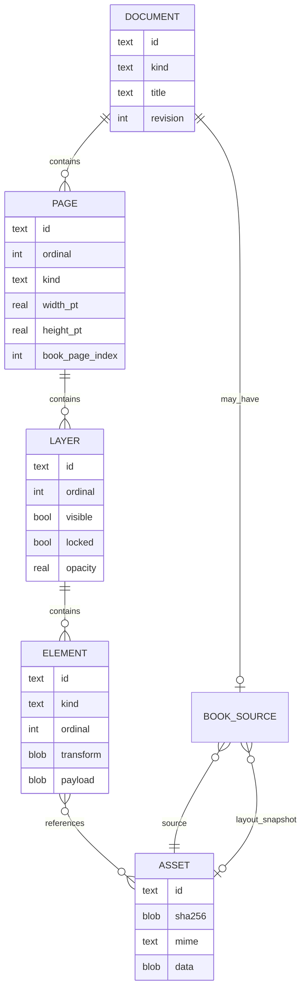

# 03 · 文档格式与数据模型（Document Format）

- 状态：Baseline v1 草案；在 Phase 1 实现前需完成技术评审
- 版本：v0.1.0
- 最后更新：2026-10-19
- 关联：[01-functional-requirements.md](01-functional-requirements.md)、[02-technical-architecture.md](02-technical-architecture.md)

---

## 1. 目标与非目标

### 1.1 目标

- 单个 `.meowo` 文件包含一篇文档的全部用户内容，可直接复制携带。
- SQLite 事务/WAL 提供崩溃恢复和增量保存。
- 笔迹为矢量，支持压力、缩放、擦除分段与选择性编辑。
- 图文、附件、图书源、图层、Markdown 文本均可版本化演进。
- 格式不依赖平台字节序或 Flutter/C++ 具体实现。
- 可验证、可迁移、可拒绝损坏/恶意输入。
- 文档内容不依赖外部路径或网络资源。

### 1.2 非目标

- 不保证旧版本应用能读取新格式文档（必须拒绝写入并提示升级）。
- 不在 1.0 支持多文档合并、增量同步或 CRDT。
- 不把数据库内部 schema 当作稳定的第三方公开 API；导出互操作只有 `.meowo` 文件级。
- 不存储 Undo 历史、UI 相机、缓存缩略图作为必要语义数据（可丢失/重建）。

---

## 2. 文件容器

### 2.1 基本属性

| 属性 | 值 |
|---|---|
| 扩展名 | `.meowo` |
| 容器 | SQLite 3 数据库（单文件） |
| 编码 | UTF-8（文本字段），二进制字段明确字节序 |
| 字节序 | SQLite 保证跨平台；BLOB 内自定义数据统一小端（除非 FlatBuffers 规范） |
| 日志模式 | WAL |
| 同步级别 | `synchronous=FULL`（至少在关键提交与退出时保证 durability） |
| 外键 | 开启 |
| Application ID | `0x4D454F57`（ASCII `MEOW`） |
| 初始 schema 版本 | `PRAGMA user_version = 1` |

打开流程必须先以只读方式或临时连接检查：

1. 文件头为 `SQLite format 3\0`；
2. `PRAGMA application_id` 匹配；
3. `PRAGMA user_version` 在支持范围；
4. `PRAGMA integrity_check`/`quick_check`（快速检查，完整检查可在后台）；
5. 关键不变量（文档类型、页面数、图层归属、资产引用、图书页映射）；
6. 文件锁/可写权限。

不符合时：不得修改原文件，返回明确错误或只读打开。

### 2.2 运行期伴随文件

WAL 模式可能产生：

```text
<name>.meowo
<name>.meowo-wal
<name>.meowo-shm
```

这些是运行期文件，不是用户文档的一部分。导出/分享时必须生成一致性快照，不能只复制主文件。

建议锁定机制使用临时锁文件：

```text
<workspace>/locks/<document-id>.lock
<workspace>/.meowo.lock          # Alpha.5 工作区级独占锁
```

锁文件不属于文档格式；异常退出后必须可安全判定陈旧锁。Alpha.5 实际使用工作区根目录 `.meowo.lock`，尚未实现单文档锁。

### 2.3 一致性快照

使用 SQLite Online Backup API 或等价机制，将打开中的文档写到一个临时 `.meowo`：

1. 在只读事务下获取一致性快照；
2. 写入临时路径；
3. 校验快照；
4. `fsync`；
5. 原子重命名到用户选择的位置/分享临时路径；
6. 失败时删除临时文件。

禁止直接 `cp` 主文件而忽略 WAL。

---

## 3. 通用约定

### 3.1 坐标与尺寸

- 单位：**point**，1 pt = 1/72 inch。
- 原点：页面/画布左上角；x 向右，y 向下。
- 页面/画布坐标使用 IEEE 754 double；持久化变换矩阵使用 6 个 little-endian float64。
- 无极画布允许负坐标，不设固定宽高。
- 书页宽度/高度由页面记录确定；内容按页面裁剪。
- 笔迹点使用“元素局部坐标”：相对元素锚点的坐标，float32；锚点为 double。C++ 在大范围内必要时拆分超长笔迹，避免 float32 精度下降。
- 缩放不改变文档坐标，只改变相机变换。

### 3.2 ID

- 文档、页面、图层、元素、资产使用 UUIDv7（128 bit）的 canonical string（36 字符，小写）。
- ID 在创建后不可变化；复制文档/元素/资产时重新生成。
- 不把行号、时间戳或标题作为对象标识。
- 导入后保留源文件内容哈希，但资产 ID 重新生成。

### 3.3 时间

- 所有持久化时间使用 Unix epoch 毫秒（UTC，有符号 64 位整数）。
- UI 按本地时区/语言显示。
- 修改时间用于排序与缓存失效，不作为逻辑时钟依赖。

### 3.4 文本

- Markdown、标题、图层名、附件名使用 UTF-8。
- 用户 Markdown 内容按输入保存；行结束统一为 LF。
- 标题展示前去除首尾空白；空标题由应用层回退为“未命名”，数据库不强制非空字符串含义。
- Unicode 规范化：标题/搜索索引可用 NFC；Markdown 内容不得擅自规范化，避免改变用户文本。

### 3.5 版本与枚举

- `PRAGMA user_version` 是格式版本唯一权威；所有迁移必须递增并附带迁移测试。
- 枚举值存储为整数或固定字符串，不使用本地化文本。
- FlatBuffers 每个表用 schema 版本/字段新增保持向后兼容；读取方必须使用 verifier。
- 未知枚举值：拒绝该元素或将整个元素标记为不支持，不得静默渲染成错误内容。

---

## 4. 逻辑模型



### 4.1 文档类型

| `kind` | 逻辑页面数 | 页面 `kind` | 说明 |
|---|---:|---|---|
| `infinite` | 1 | `canvas` | 无固定边界，无页码/缩略图 |
| `paged` | >= 1 | `paper` | 文档级统一纸张尺寸；用户页面可增删/重排 |
| `book` | >= 1 | `book` | 页面结构由图书源决定；1.0 不可增删/重排源页 |

### 4.2 纸张背景

纸张是页面属性，不是元素：

- `blank`（默认）
- `ruled`
- `dotted`
- `grid`

图书页背景不使用纸张纹理。背景参数切换不改变元素几何；由 UI 设置，可撤销与否在 UX 中定义。

### 4.3 图层

- 每个页面自动至少一个图层（默认 `Layer 1`）。
- 图层顺序从小到大绘制；元素顺序同理。
- 删除图层级联删除其元素；应用需要提示并支持撤销。
- 隐藏/锁定仅影响显示/编辑，不改变层级。

### 4.4 元素

| `kind` | 语义 | 可包含资产 |
|---|---|---|
| `stroke` | 一条完整笔迹（一次落笔；像素擦除后可分裂成多条） | 否 |
| `image` | 位图图片及裁切/旋转信息 | 是（原图） |
| `text` | Markdown 文本（文本框或本底文本） | 是（Markdown 内引用） |
| `attachment` | 画布附件图标 | 是（附件文件） |

- 图书页背景不是元素。
- 所有元素都必须有 `layer_id`、`page_id`、transform、payload、ordinal。
- 本底文本是 `text` 元素，`layout_mode=page_body`；每页最多一个，由应用层保证。
- 元素归属页必须与图层所属页一致，使用复合外键强制。

---

## 5. SQLite Schema（v1）

> 以下 SQL 是格式规范。实际实现可增加内部索引、视图、缓存或诊断表，但不得改变语义、字段含义或破坏迁移兼容。字段约束必须由数据库 + 应用双重校验。

### 5.1 文档与版本

```sql
PRAGMA application_id = 1296383831;  -- 0x4D454F57
PRAGMA user_version = 1;
PRAGMA foreign_keys = ON;
PRAGMA journal_mode = WAL;
PRAGMA synchronous = FULL;

CREATE TABLE document (
  id              TEXT PRIMARY KEY NOT NULL,
  kind            TEXT NOT NULL CHECK (kind IN ('infinite', 'paged', 'book')),
  title           TEXT NOT NULL,
  revision        INTEGER NOT NULL DEFAULT 0 CHECK (revision >= 0),
  created_at_ms   INTEGER NOT NULL,
  updated_at_ms   INTEGER NOT NULL,
  created_by      TEXT NOT NULL DEFAULT 'meowo',
  app_version     TEXT NOT NULL,
  attributes_json TEXT NOT NULL DEFAULT '{}'
);

CREATE TABLE meta (
  key   TEXT PRIMARY KEY NOT NULL,
  value TEXT NOT NULL
);
```

- `document` 必须恰好一行；应用打开时验证，写入多个/零个视为损坏。
- `revision` 每次提交文档内容事务递增；页面内轻量缓存命中不使用它作为唯一依据。
- `key` 保留给未来格式/迁移标记；不得存用户正文。
- `attributes_json` 只用于可向前兼容的非关键显示属性，不允许代替正式字段。

### 5.2 页面

```sql
CREATE TABLE pages (
  id               TEXT PRIMARY KEY NOT NULL,
  ordinal          INTEGER NOT NULL CHECK (ordinal >= 0),
  kind             TEXT NOT NULL CHECK (kind IN ('canvas', 'paper', 'book')),
  width_pt         REAL,
  height_pt        REAL,
  background_kind  TEXT NOT NULL DEFAULT 'blank'
                   CHECK (background_kind IN ('blank', 'ruled', 'dotted', 'grid')),
  background_json  TEXT NOT NULL DEFAULT '{}',
  book_page_index  INTEGER,
  created_at_ms    INTEGER NOT NULL,
  updated_at_ms    INTEGER NOT NULL,
  revision         INTEGER NOT NULL DEFAULT 0 CHECK (revision >= 0),
  UNIQUE (ordinal),
  CHECK (
    (kind = 'canvas' AND width_pt IS NULL AND height_pt IS NULL
      AND background_kind = 'blank' AND book_page_index IS NULL)
    OR
    (kind = 'paper' AND width_pt > 0 AND height_pt > 0
      AND book_page_index IS NULL)
    OR
    (kind = 'book' AND width_pt > 0 AND height_pt > 0
      AND background_kind = 'blank' AND book_page_index >= 0)
  )
);
```

补充应用不变量：

- `infinite` 文档：恰好一页 `kind='canvas'`。
- `paged` 文档：所有非书页 `kind='paper'`，且宽高相同；书页文档没有 `book` 页面。
- `book` 文档：所有页面 `kind='book'`，`book_page_index` 从 0 连续递增，且 `< book_source.page_count`。
- `book` 页面宽高由源页面尺寸生成后固定；不得由用户改变。
- 页面顺序：`ordinal` 从 0 连续；新增/重排在单个事务中重新编号。
- 纸张样式参数放 `background_json`（如线距、点距），必须做上限校验。

> `book` 与 `paper` 的 CHECK 在实现时应拆分/加强，避免复杂的优先级歧义；上面的表达式表达意图，最终 SQL 以实现测试为准。

### 5.3 图层

```sql
CREATE TABLE layers (
  id            TEXT PRIMARY KEY NOT NULL,
  page_id       TEXT NOT NULL REFERENCES pages(id) ON DELETE CASCADE,
  ordinal       INTEGER NOT NULL CHECK (ordinal >= 0),
  name          TEXT NOT NULL,
  visible       INTEGER NOT NULL DEFAULT 1 CHECK (visible IN (0,1)),
  locked        INTEGER NOT NULL DEFAULT 0 CHECK (locked IN (0,1)),
  opacity       REAL NOT NULL DEFAULT 1.0 CHECK (opacity >= 0.0 AND opacity <= 1.0),
  created_at_ms INTEGER NOT NULL,
  updated_at_ms INTEGER NOT NULL,
  UNIQUE (page_id, ordinal),
  UNIQUE (id, page_id)
);
```

- 图层名可为空字符串，但展示时回退默认名。
- 删除最后一个图层：允许但自动补一个空图层，或禁止；应用层必须保持每一页至少一个图层。
- 图层排序经 `ordinal` 重新编号，不依赖小数 z-index。

### 5.4 元素

```sql
CREATE TABLE elements (
  id            TEXT PRIMARY KEY NOT NULL,
  page_id       TEXT NOT NULL,
  layer_id      TEXT NOT NULL,
  ordinal       INTEGER NOT NULL CHECK (ordinal >= 0),
  kind          TEXT NOT NULL CHECK (kind IN ('stroke', 'image', 'text', 'attachment')),
  transform     BLOB NOT NULL CHECK (length(transform) = 48), -- 6 × float64 LE
  bbox          BLOB NOT NULL CHECK (length(bbox) = 32),      -- min_x, min_y, max_x, max_y
  payload       BLOB NOT NULL,
  created_at_ms INTEGER NOT NULL,
  updated_at_ms INTEGER NOT NULL,
  UNIQUE (layer_id, ordinal),
  FOREIGN KEY (layer_id, page_id) REFERENCES layers(id, page_id) ON DELETE CASCADE
);

CREATE INDEX idx_elements_page ON elements(page_id);
CREATE INDEX idx_elements_layer ON elements(layer_id);
```

- `transform`：$[a, b, c, d, tx, ty]$，列主序或行主序必须在实现中固定并写入测试；点映射为 `x' = a*x + c*y + tx`，`y' = b*x + d*y + ty`。
- `bbox` 是页面坐标下的轴对齐包围盒缓存，必须与实际几何一致；载入时可重算并校验。
- `ordinal` 为图层内顺序；重排在事务中重新编号。
- 插入前必须校验图层可见/锁定由应用决定；格式层只保证归属一致。
- 元素删除时，`asset_refs` 级联删除；资产本身由 GC/显式清理决定。

### 5.5 资产

```sql
CREATE TABLE assets (
  id            TEXT PRIMARY KEY NOT NULL,
  sha256        BLOB NOT NULL CHECK (length(sha256) = 32),
  mime          TEXT NOT NULL,
  original_name TEXT NOT NULL,
  byte_size     INTEGER NOT NULL CHECK (byte_size >= 0),
  width         INTEGER,
  height        INTEGER,
  data          BLOB NOT NULL,
  created_at_ms INTEGER NOT NULL,
  UNIQUE (sha256)
);

CREATE TABLE asset_refs (
  element_id TEXT NOT NULL REFERENCES elements(id) ON DELETE CASCADE,
  asset_id   TEXT NOT NULL REFERENCES assets(id) ON DELETE RESTRICT,
  role       TEXT NOT NULL CHECK (role IN (
               'image_source',
               'attachment',
               'markdown_image',
               'markdown_link'
             )),
  PRIMARY KEY (element_id, asset_id, role)
);

CREATE INDEX idx_asset_refs_asset ON asset_refs(asset_id);
```

- `data` 存原始字节（图片/附件/PDF/EPUB/生成的版面快照）。
- 资产 ID 与内容哈希独立；相同内容按 `sha256` 去重。不同文件名引用同一资产时保留 `assets.original_name` 的首个名称，UI 可显示各引用自己的标题。
- 插入资产时先完成 MIME/内容安全探测，再写 BLOB；DB 只信应用层已验证的 MIME。
- 大资产使用 SQLite incremental blob API 读写；不要总是复制整个 BLOB 到 Dart。
- 1.0 实现建议安全上限：单个资产 ≤ 1 GiB，单文档建议 ≤ 16 GiB；导入前对 >100 MiB 文件警告。上限必须有明确错误，不崩溃。
- `asset_refs` 只覆盖元素引用；图书源引用由 `book_sources` 管理。Markdown 链接/图片必须在提交文本时解析并维护引用，删除资产时用引用检查。
- 不允许删除仍被引用的资产；UI 需显示引用位置。

### 5.6 图书源

```sql
CREATE TABLE book_sources (
  document_id             TEXT PRIMARY KEY NOT NULL
                          REFERENCES document(id) ON DELETE CASCADE,
  format                  TEXT NOT NULL CHECK (format IN ('pdf', 'epub')),
  source_asset_id         TEXT NOT NULL REFERENCES assets(id) ON DELETE RESTRICT,
  layout_snapshot_asset_id TEXT REFERENCES assets(id) ON DELETE RESTRICT,
  page_count              INTEGER NOT NULL CHECK (page_count > 0),
  import_settings_json    TEXT NOT NULL DEFAULT '{}',
  toc_json                TEXT NOT NULL DEFAULT '[]',
  engine_id               TEXT NOT NULL,
  engine_version          TEXT NOT NULL,
  imported_at_ms          INTEGER NOT NULL
);
```

说明：

- `source_asset_id` 始终保留原始 PDF/EPUB，以便未来重新布局或导出。
- PDF：`layout_snapshot_asset_id` 可空；页面渲染直接读取源 PDF 的对应页。
- EPUB：**推荐**导入时生成固定分页的 PDF 版面快照作为 `layout_snapshot_asset_id`，页面渲染读取该快照的对应页。这样跨平台重开时不会因引擎分页差异造成批注错位；原始 EPUB 继续保留。Phase 0 验证该管线。
- 若 EPUB 引擎只能直接渲染而不能保存快照，则不得在未验证标注稳定性的情况下发布；可用逐页固定栅格/结构化快照替代，但必须保持页面几何稳定。
- `page_count`、页面宽高、`book_page_index` 必须一一对应快照/源页。
- `toc_json` 结构由应用定义并版本化，至少包含标题、深度、目标页索引；损坏目录不得影响文档打开。
- `engine_id/version` 记录生成版面快照的引擎，便于诊断和未来迁移；不是运行时动态链接库版本。
- 加密 PDF：不存储密码。若 1.0 不支持加密文件，导入时明确拒绝。

### 5.7 派生数据（不进入 `.meowo`，或可重建）

以下数据可以放在文档中，也可以放在工作区缓存；**不得成为唯一事实源**：

- 封面/页面缩略图；
- 全文搜索 FTS 索引；
- 图书页位图缓存；
- 渲染路径缓存；
- 最近打开位置/相机位置（可作为工作区偏好）；
- 页面元素数量统计。

若放在文档中必须能被删除并重建而不丢用户内容。v0.1 建议放在工作区缓存，减小 `.meowo` 大小。

---

## 6. 元素 Payload（FlatBuffers）

### 6.1 通用规则

- schema 位于 `packages/meowo_core/native/schema/`，生成代码入库。
- 每个 payload 顶层包含 `payload_version:uint` 和 `kind:ubyte`。
- 读取前使用 FlatBuffers verifier，限制数组/字符串长度，防止恶意分配。
- 未知字段保留不影响读取；未知 payload kind 拒绝该元素但允许打开文档其余部分（显示占位）。
- 所有颜色 `0xRRGGBBAA`（8-bit RGBA）。
- 长度/数量上限由应用验证：点数、Markdown 字节数、路径数等。

### 6.2 元素公共数据

元素公共数据均在 `elements` 表：

- `kind`；
- `transform`；
- `bbox`；
- `ordinal`、`layer_id`、`page_id`；
- `created_at_ms`、`updated_at_ms`。

### 6.3 StrokePayload

概念字段：

```text
StrokePayload {
  payload_version:uint;
  kind:ubyte = STROKE;
  brush:BrushSnapshot;
  algorithm_version:uint;
  anchor_x:double;
  anchor_y:double;
  points:[StrokePoint];
}

BrushSnapshot {
  tool:ubyte;              // pen, highlighter
  color_rgba:uint;
  width_pt:double;
  opacity:float;           // 0..1
  blend:ubyte;             // normal / multiply / screen (reserved)
  pressure_curve:[CurvePoint];
  curve_interpolation:ubyte; // linear / monotonic cubic
  smoothing_version:uint;
}

StrokePoint {
  x:float;                 // 相对 anchor
  y:float;
  pressure:uint16;         // 0..65535，原始有效压力
}
```

要求：

- 一次落笔产生一个 `stroke` 元素；像素擦除可将其分割为多个独立元素。
- 压力点必须保留，以支持重新渲染/未来曲线调整；宽度由 C++ 权威算法计算，存储最终中心线/平滑后的点。
- `algorithm_version` 与 `smoothing_version` 用于复现渲染；升级算法不得无提示改变已存笔迹形状。
- 超高点数/超长笔迹需拆分或拒绝，避免单元素过大。
- 高亮笔使用透明度；若使用 blend 模式，渲染器必须跨平台一致，不能依赖不受控的 GPU 差异。
- 压力曲线至少两个点，x 单调递增，范围 [0,1]；曲线用于未来绘制/重新求值。

### 6.4 ImagePayload

```text
ImagePayload {
  payload_version:uint;
  kind:ubyte = IMAGE;
  asset_id:string;
  crop_x:double;         // 0..1，相对原始（已应用 EXIF 方向）图像
  crop_y:double;
  crop_width:double;     // >0
  crop_height:double;
  rotation_quarter_turns:ubyte; // 0..3，顺时针 90°
  flip_horizontal:bool;
  flip_vertical:bool;
  opacity:float;
}
```

- 原图不变，裁切/旋转/翻转非破坏保存；可重新进入编辑器。
- `transform` 与裁切共同决定页面几何。裁切先于旋转/翻转还是反之必须固定（建议：裁切 → 旋转/翻转 → transform）。
- 资产引用 role = `image_source`。

### 6.5 TextPayload

```text
TextPayload {
  payload_version:uint;
  kind:ubyte = TEXT;
  markdown:string;
  layout_mode:ubyte;      // box / page_body
  auto_height:bool;
  box_width_pt:double;
  box_height_pt:double;
  font_size_pt:double;
  line_height:double;
  text_color_rgba:uint;
  align:ubyte;            // left / center / right
  style_json:string;      // 预留非关键排版，校验白名单
}
```

- `markdown` 是唯一内容事实源；不得存储 HTML 快照作为替代。
- `box`：文本框，可移动/缩放/重排；`page_body`：本底文本，页面内最多一个。
- `auto_height=true` 时高度由排版决定；固定高度时保留 `box_height_pt` 并遵循溢出策略（OQ-004）。
- 内部附件链接规范：`meowo://asset/<uuid>`；Markdown 图片：``。
- 不允许 `file://`、绝对路径或 `../` 作为持久化附件引用。
- `style_json` 必须 schema 校验，不接受任意可执行内容。
- 文本元素引用资产时维护 `asset_refs`，roles 为 `markdown_link`/`markdown_image`。

### 6.6 AttachmentPayload

```text
AttachmentPayload {
  payload_version:uint;
  kind:ubyte = ATTACHMENT;
  asset_id:string;
  caption:string;
  icon_hint:string;       // 可选，仅显示提示
}
```

- 附件图标是可选中元素，位置由 transform 决定，大小通常由 UI 固定/缩放；图标不是文件缩略图缓存。
- `caption` 可为空，回退原文件名。
- 资产引用 role = `attachment`。

---

## 7. 工作区资料库（非 `.meowo` 格式）

资料库是本地工作区，建议结构：

```text
<workspace>/
├── workspace.sqlite
├── documents/
│   └── <document-id>.meowo
├── locks/
├── cache/
│   ├── thumbnails/
│   └── book-pages/
└── logs/                  # 仅开发诊断，不存用户正文
```

`workspace.sqlite` 是 **可重建缓存**，不是唯一数据源。建议表：

```sql
CREATE TABLE catalog_documents (
  document_id   TEXT PRIMARY KEY,
  relative_path TEXT NOT NULL,
  title         TEXT NOT NULL,
  kind          TEXT NOT NULL,
  cover_png     BLOB,
  created_at_ms INTEGER NOT NULL,
  updated_at_ms INTEGER NOT NULL,
  last_opened_ms INTEGER,
  favorite      INTEGER NOT NULL DEFAULT 0,
  trashed_at_ms INTEGER,
  CHECK (favorite IN (0,1))
);

CREATE VIRTUAL TABLE catalog_search USING fts5(
  title, body,
  document_id UNINDEXED,
  tokenize = 'unicode61 remove_diacritics 2'
);
```

原则：

- 标题、类型、更新时间以文档内为准；catalog 是加速缓存，发现不一致时以文档为准并修复。
- 收藏、回收站状态、最近打开位置属于工作区偏好；文档复制到另一设备时不要求保留这些状态。
- 搜索索引只覆盖标题与文本元素，不覆盖手写/PDF/EPUB 源文字（1.0）。
- catalog 丢失时扫描 `documents/*.meowo` 重建；收藏/最近记录允许丢失，文档内容不得丢失。
- Trash 为逻辑状态，文档文件保留；永久删除才删除文件。清理失败必须可重试。
- 工作区路径不得硬编码；使用平台应用数据目录。导出/导入通过系统文件选择器。

---

## 8. 保存、事务和自动保存

### 8.1 事务边界

- 一次落笔结束、一次选择变换、一次文本提交、一次页面/图层结构操作 = 一个事务。
- 一个事务中更新：
  - 元素/页面/图层行；
  - `updated_at_ms`；
  - 文档/页面 `revision`；
  - 必要索引/引用。
- 自动保存可以将多个已提交事务批量写入数据库，但不得改变撤销语义。

### 8.2 WAL 与检查点

- 打开时启用 WAL、外键、busy timeout。
- 关闭文档时执行 checkpoint/TRUNCATE。
- 分享/导出使用快照，不依赖 WAL 文件。
- 磁盘满、权限不足时保持 dirty 状态，UI 显示失败并提供导出/重试；不得显示“已保存”。

### 8.3 崩溃恢复

- SQLite 自身恢复已提交事务。
- 应用启动扫描未关闭文档/锁文件：
  - 若文档可打开，恢复到最近提交；
  - 删除陈旧锁；
  - 不尝试从 WAL 之外的临时数据恢复未提交 UI 编辑。
- 导入操作使用临时文件 + 原子 rename，崩溃不得留下半本书。

### 8.4 文件锁

- 同一文档只允许一个可写会话。
- 锁机制优先使用 OS 级 advisory lock（POSIX `flock`/Windows `LockFileEx`），锁文件为临时 sidecar。
- 不能依赖锁文件内容作为唯一锁；异常退出后由 OS 释放，或通过进程/超时判定清理。
- 无法获取写锁时，以只读方式打开并明确提示另一个实例/窗口正在编辑。
- **Alpha.5 现状（D-032）**：工作区级 `.meowo.lock` 使用非阻塞 `flock`，第二个实例直接拒绝打开；尚未实现只读打开/另存副本。该偏差必须在 1.0 前修正或在发布说明中明确降级。

---

## 9. 迁移与兼容

### 9.1 版本策略

- `user_version` 从 1 开始；每次正式格式变更递增 1。
- 迁移脚本必须：
  1. 在事务中执行；
  2. 备份原文件（至少保留到迁移成功并校验）；
  3. 对旧 schema 的 fixture 有自动测试；
  4. 成功后校验关键不变量；
  5. 失败时回滚事务并保留原文件可用。
- 小幅新增表/字段优先采用向后兼容的 `ALTER TABLE`；结构性变更有明确迁移函数。

### 9.2 新版本拒绝

- 文档 `user_version > 当前支持版本`：以只读模式打开或拒绝写打开，提示升级。
- 不允许自动“尝试写入”未知版本。
- 不得将较新文档另存为较旧版本时静默丢失元素；若未来支持降级导出，必须逐项报告损失。

### 9.3 ABI 与格式

- FFI ABI 版本与文件 schema 版本独立。
- Flutter 与核心版本不匹配时禁止打开文档写会话。
- 文件格式迁移测试与 FFI 兼容测试分别维护。

---

## 10. 导入与导出

### 10.1 新建文档

1. 在临时位置创建数据库；
2. 写入 document、首页/图层；
3. 设置 PRAGMA 与 schema；
4. 校验；
5. 关闭连接；
6. 原子命名到 `documents/<uuid>.meowo`；
7. 更新 catalog。

### 10.2 导入 `.meowo`

1. 通过系统选择器读入/复制到临时文件；
2. 只读检查 header/app id/version/integrity/invariants；
3. 分配新 document ID、页面/元素/资产 ID（如需避免与原库冲突；若文件本来自本工作区可拒绝重复导入或复制为新文档）；
4. 写入新文档文件；
5. 更新 catalog/搜索索引；
6. 成功后显示新文档；失败清理。

> 文档 ID 在单文件内部唯一；导入为副本时应生成新 ID，以免资料库内两个文件声明同一 ID。复制文档同理。

### 10.3 导出快照

- 生成一致快照 `.meowo`；
- 校验文件；
- 通过平台分享/保存；
- 不包含工作区收藏/回收站/搜索索引；
- 不修改原文档状态。

### 10.4 导入 PDF/EPUB

详见 [02-technical-architecture.md](02-technical-architecture.md) 的图书导入流程。格式要求：

- 原始文件写入 assets；
- 页数、页面尺寸、TOC、引擎信息写入 `book_sources`；
- EPUB 固定版面快照写入 assets，并生成页面映射；
- 导入全部在临时数据库/临时文件完成，成功后原子移动；
- 失败/取消不进入资料库，不留下孤儿大文件。

---

## 11. 安全与完整性校验

打开/导入时至少校验：

1. SQLite header、application_id、user_version；
2. schema 中必需表/字段存在；
3. 文档类型与页面结构；
4. 页面宽高在合理范围（如 1 pt–100,000 pt）；
5. 元素数量、payload 大小、字符串长度、数组长度上限；
6. `transform`/`bbox` 长度与有限数值（拒绝 NaN/Inf）；
7. 图层与页面归属；`asset_refs` 外键；
8. 图书页索引在范围内、类型与页面类型匹配；
9. FlatBuffers verifier 通过；
10. 资产 MIME 与大小合理；
11. 不允许外部资源路径进入持久字段。

对于不可信输入：

- 不执行任何嵌入 HTML/脚本；渲染层白名单；
- EPUB 解压防 zip slip、绝对路径、符号链接、超量文件/压缩炸弹；
- 图片解码失败只影响当前元素；
- PDF/EPUB 引擎错误隔离；
- 不使用文档内路径直接打开系统文件。

---

## 12. 格式不变量测试清单

每个格式变更/发布前必须通过：

- [ ] 新建无极文档：1 个 canvas 页，无宽高，可元素读写。
- [ ] 新建书页文档：纸张宽高统一，至少 1 页，可增删/重排且 ordinal 连续。
- [ ] 书页/画布每页至少 1 个图层；元素不能跨页归属。
- [ ] 所有元素 kind 与 payload 匹配；未知 kind 打开时不崩溃。
- [ ] 笔迹保存/重开：点数、压力、锚点、变换、图层一致。
- [ ] 像素擦除产生多个合法片段，撤销恢复原始。
- [ ] 图片裁切/旋转参数保存后重开一致。
- [ ] 文本 Markdown 原样保存（除 LF 规范化）；链接资产引用正确。
- [ ] Markdown 图片/附件引用计数、删除保护正确。
- [ ] 图书页索引连续且在页数范围内；PDF/EPUB 源资产存在。
- [ ] 资产 sha256 校验通过；重复资产去重不破坏引用。
- [ ] 保存中途模拟失败：旧 DB 仍可打开，无半文档。
- [ ] WAL 未 checkpoint 时强行终止：重开恢复已提交内容。
- [ ] 快照导出的文件无 WAL 依赖，在另一平台打开成功。
- [ ] schema 迁移成功、失败回滚、旧版本拒绝新版本的测试。
- [ ] 恶意大字段/路径/压缩文件被拒绝，不 OOM。
- [ ] 同一文档第二个写会话被拒绝或只读。
- [ ] 未知 FlatBuffers 字段/未知枚举的降级行为有测试。

---

## 13. 未来演进提示

- 同步：需要文档级 revision、稳定 ID、资产哈希与变更日志；当前格式保留 `revision`，但没有网络冲突策略。
- 页面结构变化：书页调整纸张/方向需要全量重映射，不能偷偷原地改尺寸。
- EPUB 重新分页：会改变页面索引和批注位置，必须保留旧布局或创建新版本。
- 文本流自动跨页：需要文档级文本流/锚点模型，不应复用“每页一个 body text”来伪装。
- 导出 PDF/PNG：应由渲染层生成，不改变 `.meowo` 真源。
- 加密：若未来加入文档加密，必须有独立头/密钥策略与迁移路径，不能只加一个 SQLCipher 密钥字段就宣称安全。
